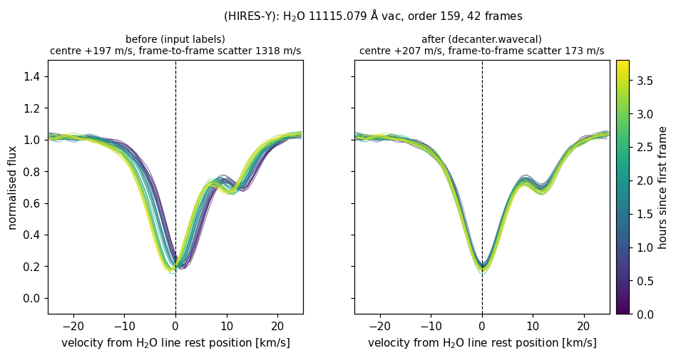

Wavelength calibration
======================

WARP's wavelengths come from the period ThAr solution, plus a cross-frame
shift that moves every frame of a night onto one reference frame (its s10/s11
step). Neither follows the instrument's drift during the night in absolute
terms, so telluric lines wander by up to a few km/s from frame to frame.

``decanter``'s default mode keeps the ThAr solution as a fixed shape and
measures what moves on the atmosphere, frame by frame:

* **OH airglow** in the sky spectra gives the instrument's zero point;
* **telluric H2O** in the object spectra gives the starlight's zero point,
  tied to the OH one by a fitted slope;
* low-order detector modes (position along the order, order number) and a
  smooth drift + A/B nod time model across the night.

Every order of every frame is then moved onto its true (telluric) wavelength
scale through WARP's own s11 shift, so every product — the vacuum and air
spectra, the normalised ones, the night's sums — is calibrated consistently.
Nothing is resampled more than WARP already does.

Using it
--------

It is on by default:

.. code-block:: python

   import decanter

   calib = decanter.Calibration.from_dir("calibration_LCO25b_setting2_HIRES-Y100")
   series = decanter.reduce_many(frame_pairs, calib)        # mode="default"
   series.wavecal.z_star, series.wavecal.z_star_err         # km/s per frame

   tree = decanter.reduce_to_warp_tree("TOI2109.txt", "science_data/2025_08_07",
                                       calib, "reductions/TOI2109",
                                       paramfile="nominal_params.txt")

A single frame (``decanter.reduce``) or a few RV epochs use the same lines
frame by frame; when the calibration set holds a stored static surface (a
small JSON file built from full nights with
:func:`decanter.wavecal.build_static_surface`), its per-line offsets put a
single frame on the same absolute scale as a night.

``mode="warp-clone"`` turns all of this off and reproduces WARP to the bit,
cross-correlation shift included.

The check plot
--------------

:func:`decanter.wavecal.telluric_check` draws one unsaturated, isolated H2O
line in every frame of a night, before and after the calibration.
``reduce_to_warp_tree`` writes it to
``reduction_log/decanter_wavecal_telluric.png`` (``wavecal_check=False``
skips it). For a series in memory:

.. code-block:: python

   import decanter.wavecal as wc

   series = decanter.reduce_many(frame_pairs, calib, mode="warp-clone",
                                 waveshift=False)      # uncalibrated, unshifted
   night = wc.night_from_reductions(series.reductions,
                                    wc.ThArTemplate.from_calibration(calib))
   sol = wc.anchor(night)
   wc.telluric_check(night, sol, "TOI2109_telluric.png")

TOI-2109 (HIRES-Y, 42 frames over 3.8 h). Left: the frames on their ThAr
wavelengths; the line drifts by ~3 km/s through the night. Right: after the
calibration, every frame's line sits at its rest position:

Across 59 WARP nights the frame-to-frame scatter of the line centre drops from
a median of 152 to 77 m/s.
